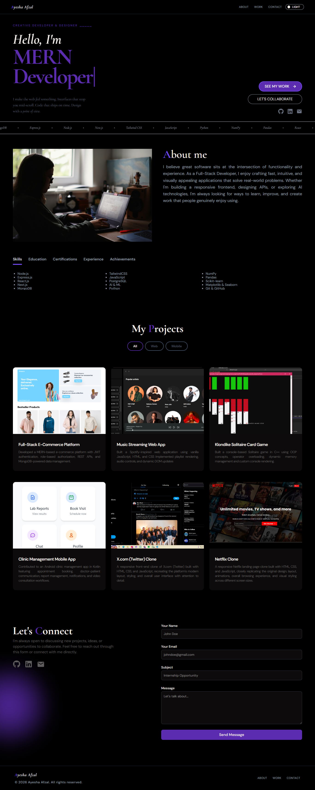

# Ayesha Afzal: Developer Portfolio

A personal portfolio website showcasing my projects, skills and background as a full stack developer. Built with React and Vite and deployed on Vercel.

🔗 **Live Site:** https://ayeshaafzal.vercel.app/

## Sections
- Home / Introduction
- About Me
- Skills
- Projects
- Contact (working contact form with email delivery)
- Dark / light theme toggle

## Tech Stack
React.js · Vite · JavaScript · EmailJS . Tailwind CSS · Vercel

## What I Practiced
- Building a multi-section responsive website with React components
- Structuring a project with Vite for fast development and builds
- Deploying and maintaining a live site on Vercel
- Designing a clean UI that works on desktop and mobile

## Run Locally
```bash
git clone https://github.com/AyeshaAfzal-01/ayesha-portfolio.git
cd ayesha-portfolio
npm install
npm run dev
```
Then open the local URL shown in the terminal (usually http://localhost:5173).

## Build for Production
```bash
npm run build
```

## Screenshot

<!-- Upload a screenshot of your site and update this path -->

## Future Improvements
- Add a blog or case-study section for projects
- Improve SEO and page performance

## Contact
**Ayesha Afzal**
[GitHub](https://github.com/AyeshaAfzal-01) · [LinkedIn](https://www.linkedin.com/in/ayesha-afzal01)
